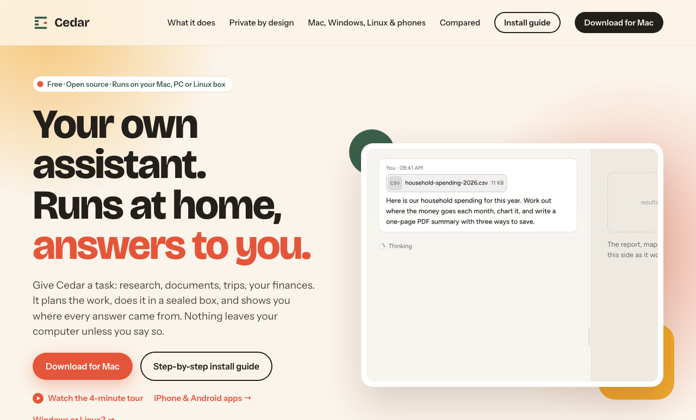
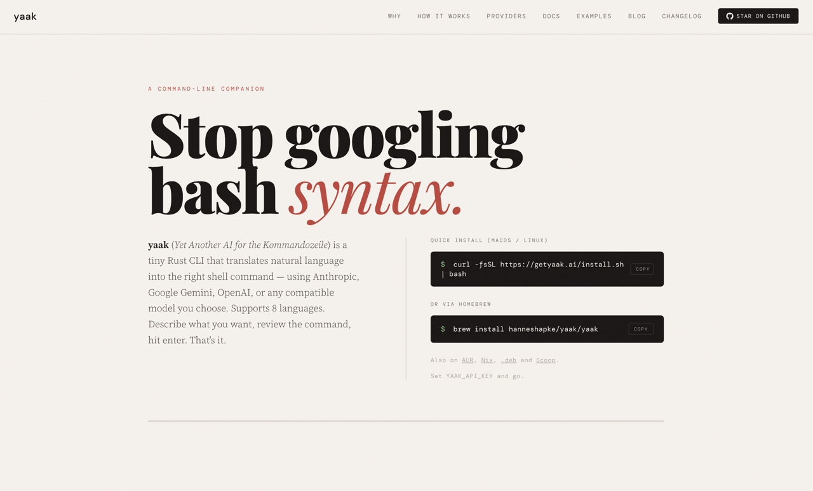
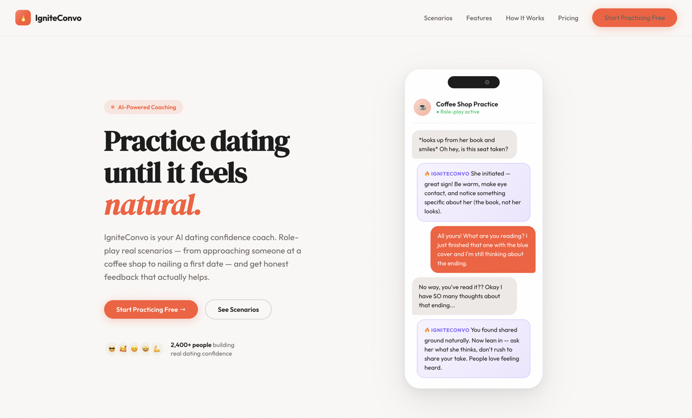
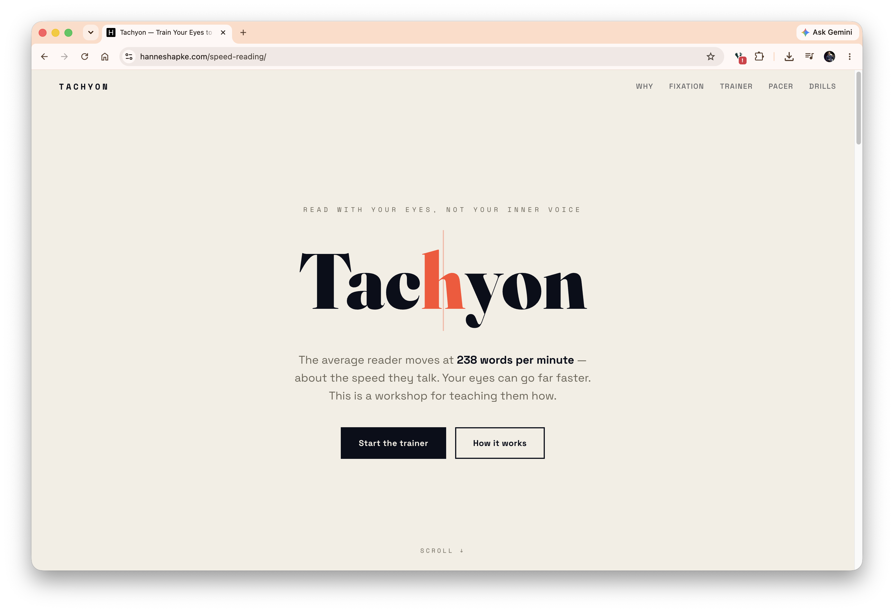

Side projects and product experiments.

---

## Cedar — your own AI assistant, running at home

*Your own assistant. Runs at home, answers to you.* A free, **open-source personal AI assistant** that runs on your own machine. Give it a task like research, documents, trip planning or your finances. Cedar plans the work, does it in a sealed sandbox and shows you where every answer came from. Your model, conversations and files stay on your computer unless you say otherwise.

- **Rust backend** that runs LLM agents against any OpenAI-compatible server, with each run's tools executing in their own Docker or [OpenShell](https://github.com/NVIDIA/OpenShell) sandbox
- Bring your own model: Ollama, LM Studio, llama.cpp or vLLM locally, or a hosted provider with an API key
- Plans you approve, approvals before risky actions, a separate on/off switch for each tool, memory you can inspect, and scheduled agents
- Desktop apps for Mac, Windows and Linux, plus iPhone and Android companions paired over Tailscale
- Apache 2.0

[getcedar.io →](https://getcedar.io) · [GitHub →](https://github.com/hanneshapke/cedar)

---

## yaak — a command-line companion

*Yet Another AI for the Kommandozeile.* A tiny **Rust CLI** that translates natural language into the right shell command — using Anthropic, Google Gemini, OpenAI, or any compatible model. Describe what you want, review the command, hit enter.

- 8-language support, provider-agnostic backend
- Install via `curl | bash`, Homebrew, AUR, Nix, `.deb`, or Scoop
- Set `YAAK_API_KEY` and go

[getyaak.ai →](https://getyaak.ai)

---

## IgniteConvo — AI dating confidence coach

An **AI-powered coaching app** for practicing real dating scenarios — from approaching someone at a coffee shop to nailing a first date — with role-play and honest feedback that actually helps. 2,400+ users building real dating confidence.

[igniteconvo.co →](https://igniteconvo.co/)

---

## Tachyon — train your eyes to read faster

A browser-based **speed-reading workshop** that teaches your eyes to move faster than your inner voice. The average reader moves at ~238 words per minute — about talking speed — and Tachyon trains the habits to go well beyond that.

- **Fixation** training to widen your visual span beyond one word at a time
- An **RSVP trainer** that flashes words at a fixed point to kill eye movement
- A **pacer** that sweeps a highlight across text to set rhythm and stop regression
- Five-minute daily **drills** for subvocalization suppression and comprehension

[hanneshapke.com/speed-reading →](https://www.hanneshapke.com/speed-reading/)
